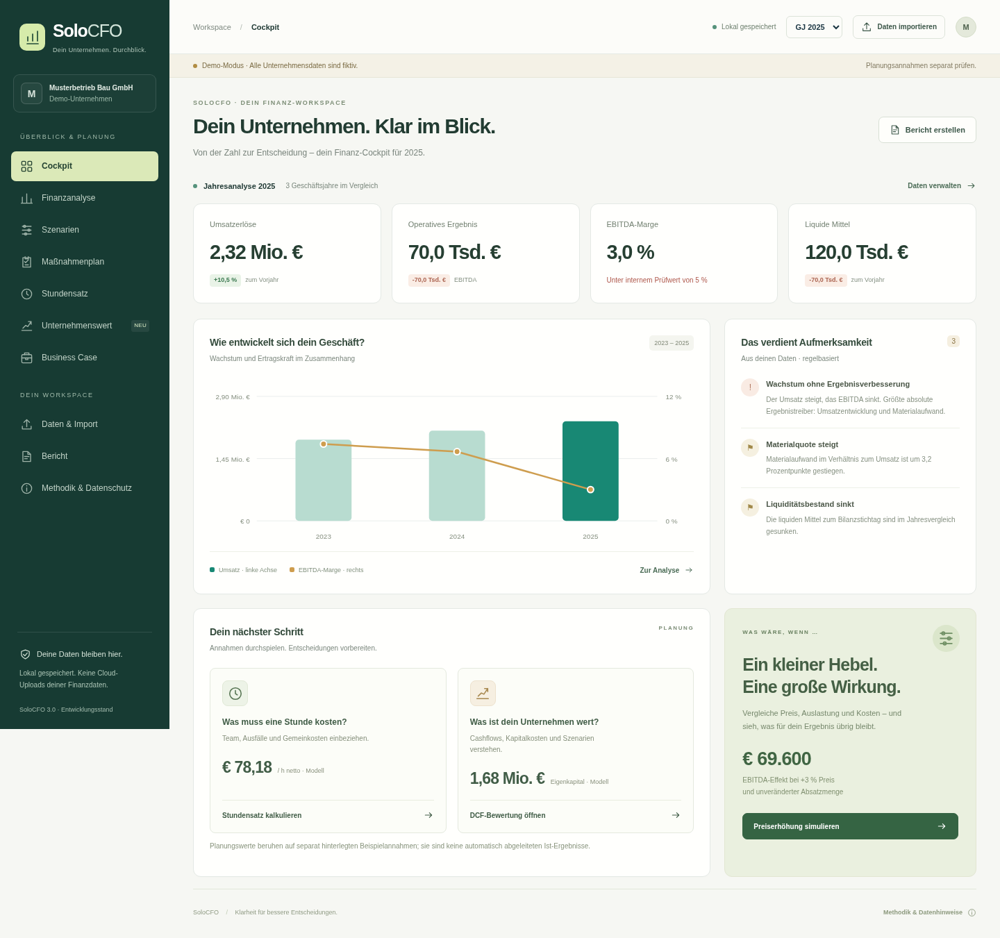

# SoloCFO 3.0 – Finanz-Workspace

Weiterentwicklung des mitgelieferten MVP 2.0: eine deutschsprachige, lokal arbeitende Web-App mit DCF-Unternehmensbewertung, detaillierter Stundensatzplanung und Unternehmensszenarien. **Entwicklungsstand zum Erproben, kein freigegebenes Finanzprodukt.**



## Direkt ausprobieren

`dist/SoloCFO_v3_Offline.html` herunterladen und auf einem privaten Rechner in einem aktuellen Browser öffnen. Die Datei enthält Oberfläche, Styles und Berechnungen vollständig. Keine Installation, externen Fonts, API-Schlüssel oder KI-Dienste nötig. Die App beginnt mit ausdrücklich fiktiven Unternehmensdaten und separat gekennzeichneten Beispielannahmen.

Für die Web-Version aus dem Projektverzeichnis:

```sh
npm run dev
```

Das startet den Python-Webserver auf Port 8080 mit `web/` als Inhalt. Node.js ab 20 und Python 3 werden für den Entwicklungsablauf benötigt. Die Web-App selbst hat keine Paketabhängigkeiten; `npm install` ist dafür nicht nötig. Die vorhandenen Capacitor-Pakete betreffen ausschließlich den optionalen, hier nicht getesteten iOS-Wrapper.

## Was neu ist

- **Cockpit:** überarbeitete Oberfläche, Demo-Kennzeichnung, Umsatz-/Margenentwicklung mit getrennten Achsen, regelbasierte Hinweise und direkte Planungseinstiege. Responsiv auf Desktop und Smartphone.
- **Unternehmenswert:** DCF im Entity-Ansatz mit fünf einzeln editierbaren Planjahren, FCFF-Rechnung, nachhaltiger Reinvestition, Wertbrücke, WACC-/Wachstums-Sensitivität und drei Annahmenvarianten. Vollständige Jahresrechnung und Grundlagen als CSV.
- **Stundensatz:** bis zu 20 Mitarbeitergruppen mit FTE, Brutto, Bezügen, Dienstgeberzuschlag, Zusatzkosten, Wochenstunden, Ausfalltagen und Verrechenbarkeit. Neun Gemeinkostenkategorien, Unternehmerlohn, Material-/Fremdleistungsdeckungsbeiträge, Reserve, Zielmarge und Vergleich mit dem aktuellen Satz. Auslastungssensitivität und Kalkulations-CSV.
- **Unternehmensszenarien:** Preis, Menge, zusätzlich verrechenbare Leistung, variable Kostenanteile, Personal, Neueinstellungen, Investitionen, Plansteuern und Kapitalbindung. EBITDA- und Cashflow-Effekt getrennt. Alternativen benennen, speichern, laden, löschen und vergleichen.
- **Bericht:** druckbare DCF- und Stundenplanungsabschnitte mit Datenbasis, Formeln und Grenzen. PDF über die Browser-Druckfunktion.
- **Datenverwaltung:** CSV-Import, Jahresdateneditor und JSON-Backups erhalten. Import vor Übernahme bestätigen; Fehlwerte bleiben unbekannt. Fehlerhafte Backups werden vor dem Ersetzen des Projekts abgewiesen. CSV-Exporte schützen Textfelder vor Tabellenformeln und verwenden Dezimalkommas.
- **Offline:** aktualisierter PWA-Cache und reproduzierbar erzeugte einzelne HTML-Datei.

## Ein sinnvoller Probelauf

1. Im **Cockpit** die drei Demo-Jahre vergleichen, in der **Finanzanalyse** die EBITDA-Brücke ansehen.
2. Unter **Stundensatz** Fachkräfte öffnen. Gehalt, Urlaub und Verrechenbarkeit verändern; Zielpreis und Kostenuntergrenze vergleichen. Teilzeit als FTE mit Vollzeit-Gehalts-/Stundenwerten erfassen.
3. Unter **Unternehmenswert** Planmargen, Investitionen, NWC und WACC hinterlegen. Die Beispielplanung unterstellt eine Erholung der EBIT-Marge; das ist **keine** aus den Ist-Zahlen abgeleitete Prognose. Wertbrücke und Sensitivität prüfen.
4. Unter **Szenarien** z. B. „Preise +3 %“ und „Auftragsrückgang“ anpassen, benennen und speichern. Im **Maßnahmenplan** vergleichen.
5. Im **Bericht** Ergebnisse prüfen und als PDF drucken. JSON-Backup und Modell-CSV zusätzlich exportieren.

## Berechnungen und Annahmen

### DCF

Stichtag: Ende des Basisjahres. Der erste FCFF fällt am Ende des ersten Planjahres an. Wachstum, EBIT-Marge, Abschreibungen, Capex und operatives NWC werden pro Planjahr hinterlegt.

```text
NOPAT = EBIT − max(0, EBIT) × Plansteuersatz
FCFF = NOPAT + Abschreibungen − Investitionen − ΔNWC
Enterprise Value = Σ FCFFₜ/(1+WACC)ᵗ + Endwert/(1+WACC)ⁿ
Eigenkapitalwert = Enterprise Value + Überschussliquidität − Finanzschulden + Korrekturen
```

Nachhaltiger NOPAT: letzter Planumsatz × (1+g) × letzte EBIT-Marge × (1−Steuersatz). Nachhaltige Netto-Reinvestition: `NOPAT × g / ROIC`. Nachhaltiger FCFF: `NOPAT × (1−g/ROIC)`. Endwert: `nachhaltiger FCFF / (WACC−g)`. Dieser Ansatz ersetzt für den Endwert die Capex-/NWC-Annahmen der Detailplanung und vermeidet investitionsfreies ewiges Wachstum.

WACC und ROIC müssen jeweils größer als g sein; g darf im Modell nicht negativ sein. Frühere Verlustjahre sind möglich, das letzte Planjahr benötigt eine positive EBIT-Marge. Keine Verlustvorträge oder sofortigen Steuererstattungen. Negative Eigenkapitalwerte bleiben sichtbar. Die Sensitivität ist kein Konfidenzintervall; die Varianten enthalten keine Wahrscheinlichkeiten.

„Ist-Daten übernehmen“ überträgt Basisjahr, Umsatz, NWC, Kasse und Finanzschulden. Planjahre bleiben unverändert. **Kasse anschließend auf tatsächlich überschüssige Mittel abgrenzen.** WACC, ROIC und Bewertungskorrekturen sind manuelle Annahmen. Keine automatische Kapitalmarktanbindung oder Bewertung nach KFS/BW 1 / IDW S 1.

### Detaillierter Stundensatz

```text
Personalkosten/Gruppe = FTE × [Monatsbrutto × Bezüge × (1+DG-Zuschlag) + Zusatzkosten]
Verrechenbare Stunden = Σ FTE × (260−Ausfalltage) × Wochenstunden/5 × Verrechenbarkeit
Material-/Fremdleistungs-DB = Einstand × Aufschlag
Kostenbedarf = max(0, (Personal+Gemeinkosten) × (1+Reserve) − weitere DB)
Kostenuntergrenze = Kostenbedarf / verrechenbare Stunden
Zielsatz = Kostenuntergrenze / (1−Zielmarge)
```

Kalenderannahme: 52 Wochen, 5 Arbeitstage. Nur Ausfälle auf tatsächlichen Arbeitstagen zählen; Ausfalltage und unverrechenbare Restzeiten nicht doppelt abziehen. Zielmarge auf **Stundenumsatz nach Deckung des übrigen Kostenbedarfs inklusive Reserve**, nicht auf den Gesamtumsatz mit Material. Unternehmerlohn und Reserve sind kalkulatorische Positionen; das angezeigte Ergebnis ist kein bilanzielles EBITDA. Produktive Inhaber ggf. mit Stunden erfassen, ihren Unternehmerlohn nicht doppelt rechnen. Dienstgeberkosten sind eigene Annahmen, keine automatische österreichische KV-/SV-Berechnung. Alle Preise netto ohne USt.

Ohne verrechenbare Stunden gibt es keinen Preis. Fehlende Werte und unrealistische Zeitbudgets führen zu Fehlermeldungen statt Nullannahmen. Deckt der Material-/Fremdleistungs-DB bereits den gesamten Kostenbedarf, beträgt die Stundenuntergrenze 0; ein Hinweis erklärt diesen Fall.

### Unternehmensszenarien

Zusätzliche verrechenbare Leistung wirkt auf den Leistungsanteil am bereits durch Preis und Menge veränderten Umsatz. Material und Gemeinkosten reagieren entsprechend ihren variablen Anteilen auf die Menge. Neueinstellungen: 14 Bezüge × Arbeitgeberkostenfaktor. Keine automatische Kapazitäts- oder Nachfrageprüfung.

Forderungen skalieren mit Umsatz, Vorräte und Lieferverbindlichkeiten mit Materialaufwand. Verbesserte Laufzeiten verändern Bestände um `Jahresumsatz bzw. Material / 365 × Tage`. Freisetzungen sind auf den jeweiligen Bestand begrenzt. Stichtagsindikatoren, keine belegten Laufzeiten.

```text
Cashflow-Effekt Jahr 1 = ΔEBITDA − Δoperative Plansteuern − ΔNWC − Zusatzinvestition
```

Zusätzliche lineare Ganzjahresabschreibung beeinflusst die Plansteuern. Bei fehlenden Abschreibungen/NWC-Beständen oder Umsatz/Material von 0 gibt es keinen Cashflow-Wert. Finanzierung, Zinsen, Tilgung, USt., Saisonalität und Steuerfälligkeiten fehlen. Gespeicherte Alternativen werden auf den **aktuellen Ist-Daten** ihres Basisjahres neu berechnet; ihre Effekte sind nicht addierbar.

## Architektur und Daten

| Pfad | Zweck |
|---|---|
| `web/assets/engine.js` | Bestehende GuV-, Kennzahlen-, CSV- und Business-Case-Logik |
| `web/assets/models.js` | Reine, separat testbare DCF-, Stunden- und Szenariomodelle |
| `web/assets/app.js` | Oberfläche, Zustandsmigration, Backups und Exporte |
| `web/assets/style.css`, `workspace.css` | Bestehende Basis und neue Gestaltung |
| `web/sw.js`, `manifest.webmanifest` | PWA und Offline-Cache |
| `scripts/build.cjs` | Erzeugt einzelne HTML-Datei aus den Web-Quellen |
| `test-engine.cjs`, `tests/models.test.cjs` | Regressionen und neue fachliche Prüfungen |
| `tests/browser_check.py` | Browser-Flows, Responsive-, PDF- und Offline-Prüfungen |

Der Speicher `solocfo-mvp-v2` wird weiterverwendet. Projekte aus v1/v2 erhalten neue, separat gekennzeichnete Planmodelle. Die frühere einfache Stundenkalkulation bleibt im Backup, wird aber nicht stillschweigend in Mitarbeitergruppen umgerechnet. CSV-Import ändert die separaten Planannahmen nicht. JSON-Backups enthalten neue Modelle und Unternehmensszenarien.

## Tests und Build

```sh
npm test
npm run build
# Bei laufendem Entwicklungsserver, Playwright für Python und Chromium erforderlich:
npm run test:browser
```

Stand 29.10.2026: bisherige Regressionen erfolgreich; **48 zusätzliche Modell-/Importtests bestanden**. Dazu zählen unabhängig berechnete Referenzwerte, Fehlwerte, Verlustjahre, nachhaltige Reinvestition und Null-Verrechenbarkeit. **12 Browser-Prüfgruppen bestanden**: Speicherung/Wiederladen, blockierte Speicherung, fehlerhafte Backups, Exporte, PDF, 10 Ansichten bei 360/390/768/1024 px, eigenständiges HTML ohne zusätzliche Assets und PWA-Neustart ohne Netzwerk.

Der verwaltete Cloud-Chromium sperrt `file://`. Die unveränderte HTML-Ausgabe wurde über einen temporären lokalen Server geladen und anschließend mit abgeschaltetem Netzwerk bedient. Direkter Datei-Doppelklick im Cloud-Browser wurde **nicht** als bestanden gewertet. Außerhalb der Cloud sind Dateispeicherung und localStorage browserabhängig; ggf. Web-Version lokal verwenden. Safari/iOS, native Builds und Produktionssicherheit wurden nicht geprüft.

Der Build ist deterministisch; nach Quelländerungen `npm run build` ausführen. Browserprüfungen schreiben Screenshots und eine Test-PDF in das ignorierte Verzeichnis `test-results/`. System-Chromium wird automatisch gesucht; alternativ `CHROMIUM_PATH` setzen. Ein anderer Entwicklungsserver kann mit `SOLOCFO_URL` angegeben werden.

## Bewusste Grenzen

Keine Benutzerkonten, Mandantentrennung, verschlüsselte Speicherung oder Cloud-Synchronisation. Keine automatische PDF-/XLSX-Auslesung, Buchhaltungsanbindung, KI-Erklärung, verifizierten Benchmarks oder integrierte GuV-Bilanz-Liquiditätsplanung. Der dreijährige Business Case bleibt ein vereinfachtes separates Modell. Keine Veröffentlichung oder App-Store-Einreichung vorgenommen.

Finanzdaten werden nicht an externe Dienste übertragen. localStorage und JSON-Backups sind unverschlüsselt. Dies ist **keine produktive Speicherarchitektur für vertrauliche Mandantenunterlagen**. Zunächst mit fiktiven Daten testen. Vor kommerziellem Einsatz Fachmodelle, Datenschutz, Rechte und Sicherheit prüfen; siehe `VEROEFFENTLICHUNG.md`.
